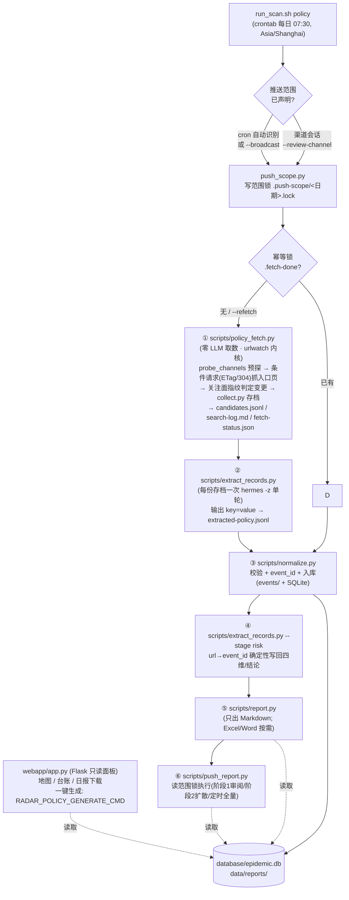

# ARCHITECTURE.md · 系统架构与数据流

> 本分支只监测**外国政府/国际组织动植物检疫政策变化**（`record_type=policy`）。疫情事件管线已移除，勿重新引入。字段权威定义见 `docs/event-schema.md`，运行约定见 `AGENTS.md`。

## 1. 整体流程

> **2026-10-25 P4 起**：默认链路改为「脚本开车、LLM 只当顾问」——取数零 LLM，抽取每份存档一次单轮微调用。旧的 Agent 会话链路保留在 `--agent` 开关后（仅排障/对照用）。下图是当前生产链路。



三条触发路径殊途同归：

1. **定时路径**：crontab → `run_scan.sh policy --broadcast` → 确定性管线 → 日报 + 推送。
2. **会话/人工补数**：`run_scan.sh policy --stage fetch`（带超时看护/幂等锁/预算刹车，scope 强制 none），再 `--stage process` 只加工已有存档。
3. **面板路径**：浏览器点"生成今日政策日报" → webapp 执行 `RADAR_POLICY_GENERATE_CMD`（默认即 `report.py --excel --docx`），只重新汇编已入库记录，不触发检索。

### 1.1 取数段的确定性边界（诚实取舍）

`fetch_pages.py` 走**链接启发式**：抓入口页 → 抽链接 → 解析链接/锚文本里的日期 → 7 天窗口过滤 → 无日期线索但"像文章"的链接再并行验文章页日期。因此：

- **覆盖**：能列出文章链接、且日期可从链接或页面结构化线索（JSON-LD / `article:published_time` / `<time datetime>`）取得的条目；
- **不覆盖**：需要 `web_search` 才能发现的条目（如输华双边议定书）、纯 JS 渲染且无结构化日期的列表页；
- **兜底**：`scripts/parse_eping.py` 已实现 ePing 通报的「日期窗口 + 措施动作 + PDF 直链」预筛，**尚未接入确定性管线**（缺一个确定性的 ePing 列表数据获取方式），是覆盖率的下一步杠杆。

## 2. 各环节的输入输出规范

### 2.1 取数段（scripts/fetch_pages.py 确定性管线 · global-policy-search skill 交互入口）

| 项 | 内容 |
|---|---|
| 确定性取数 | `scripts/policy_fetch.py`：**零 LLM**。内核是 urlwatch 2.29 引擎的移植版（`scripts/fetchlib/`：作业模型 / 过滤器链 / 缓存抽象 / 状态机 / 四态判定，零第三方依赖）。当日源清单由 `scripts/scan_targets.py` 渲染（`config/sources.yaml` 的 `policy_watch_countries` 六档，2026-10-25 起**每日全扫**，`shard`/`weekly_shards` 已废弃）→ `scripts/probe_channels.py` 预探（curl 8 并发，四层降级：`--http1.1` / SSL 宽松+超时×3 / 403 去 UA / 5xx 加长；`[dead]` 通道直接跳过）→ **条件请求**（ETag / If-Modified-Since / 304）抓入口页 → **关注面指纹**（`html2text → strip → sha1sum`）判定变更 → 抽链接 + 多语种日期窗口过滤（7 天）→ `scripts/collect.py` 存档 → `candidates.jsonl` 逐条追加 → `search-log.md` 逐源留痕 → `fetch-status.json` 状态汇总。旧取数器 `scripts/fetch_pages.py` 保留为 `POLICY_FETCH_ENGINE=legacy` 对照开关（逐日对照无差异后删） |
| 交互式检索 | `skills/global-policy-search/SKILL.md`：会话内的检索入口（`web_search` + 官方域直击 + 中文聚合站/输华议定书通道）。**会话补数一律走 `run_scan.sh policy --stage fetch`**，不再自行拼 `hermes -z` 扫描 prompt |
| 产出 | `data/raw/<日期>/`：每条存档 = 正文文件 + `.meta.json`（`collect.py` 成对落盘）；`candidates.jsonl`（候选清单）；`extracted-policy.jsonl`（抽取结果）；`search-log.md`（逐源留痕，含"预探 dead"/"无窗口内条目"等状态）；`fetch-status.json`（per-source 状态汇总：存活源数 / 变更数 / `infra_failure`，是 `run_scan.sh` 产物终检的输入之一——**存活源 0 = 基础设施故障，不是安静日**，此时中止本轮不推送「今日无新增」，见 known-issues H20） |
| 硬上限 | 当日存档 **≤12 条**（`collect.count_archives()` 按 `*.meta.json` 计条数，交付文件不占配额）；每源 ≤2 条。触顶即拒绝并记 search-log |
| 幂等 | `data/raw/<日期>/.fetch-done` 标记当日取数已交付；重复取数直接跳过，强制重取须显式 `--refetch` |
| 预算 | `scripts/token_budget.py`（读 Hermes `state.db`，东八区当日折合 ≥400 万即跳过取数，降级为"只加工已有存档"） |

### 2.2 抽取段（scripts/extract_records.py 单轮微调用 · prompts/policy-extraction.md 字段规则）

| 项 | 内容 |
|---|---|
| 输入 | `data/raw/<日期>/*.meta.json` + 对应正文摘录（`scripts/snip.py` 硬性 ≤4KB） |
| 调用 | **每份存档一次** `hermes -z` 单轮微调用（无工具循环）；prompt = 字段模板 + 摘录；输出 `key=value` 行（prompt 与输出均不含 ASCII 双引号/反引号/`$`） |
| 输出 | `data/raw/<日期>/extracted-policy.jsonl`（逐行 JSON，`source.*` 落嵌套）；单份失败（429/超时/坏输出）重试 1 次后跳过并记 search-log，**只废单份** |
| 字段规则 | `prompts/policy-extraction.md` 是人类可读版，**与 `docs/event-schema.md` 同步**；枚举取值为中文；原文没有的信息留 null，严禁编造 |
| 交互式抽取 | `--agent` 模式下由 Hermes 会话按同一套 prompt 抽取（分块取数 + 就地抽取），产出同样的 `extracted-policy.jsonl` |

### 2.3 scripts/normalize.py（数据合同权威实现）

| 项 | 内容 |
|---|---|
| 输入 | 政策记录 JSON（`--input`，支持 `-` 读 stdin）；`--db` 写库；`--out` 写 `data/events/<日期>/` |
| 校验 | `record_type=policy`；必填 `country_cn/country_en/source`；action_type/policy_domain/impact_type/impact_level/china_relevance/verification_status 枚举强校验 |
| event_id | `sha1(policy\|country_en\|policy_domain\|action_type\|主体\|生效日期)` 前 12 位，幂等主键 |
| 合并策略 | 重复入库默认合并更新：空值与 `DEFAULT_SENTINELS`（`verification_status=unverified`、`policy_status=已生效`）不覆盖已有核验/研判结论；整行替换须显式 `--replace` |

### 2.4 policy-verification（skill，官方核验）

| 项 | 内容 |
|---|---|
| 输入 | 待核验政策记录 + 其 `source.url` 原文 |
| 官方优先级 | 政府公报/检疫机构公告 → WTO ePing 通报原文（G/SPS/N 编号）→ 国际组织正式决定 → 权威媒体（仅作线索，必须回溯原文） |
| 输出 | `verification_status`：verified / single_source / unverified / false_positive（内部合并用 merged，由代码产生，不手写） |

### 2.5 prompts/policy-impact.md（对华影响研判）+ scripts/risk.py（写回）

| 项 | 内容 |
|---|---|
| 输入 | 已核验政策记录 + 中国贸易背景（海关总署公告**仅作背景**，不入台账） |
| 加权合同 | `impact_score = trade*0.35 + biosecurity*0.30 + response*0.25 + alignment*0.10`；≥3.5 高影响 / ≥2.0 中影响 / 其余低影响；高→立即关注、中→持续观察、低→常规记录 |
| 写回 | `risk.py --event-id <id> --dim trade=4 --dim biosecurity=3,...`；四维齐全时 score/level/focus 由代码推导并强校验，不得手写冲突值；`--list-pending` 列出待研判记录 |
| P4 确定性写回 | `extract_records.py --stage risk`：normalize 之后，按当日 `source.url → event_id` 把抽取记录里的四维/结论**确定性**写回（研判字段并入同一次微调用，不额外消耗一次 LLM）。字段不全的记录留给 `--list-pending` 人工补 |
| 输出 | 写回库中的 `impact_score / impact_level / impact_focus / impact_type / china_relevance / recommended_action / rationale` |

### 2.6 report.py / report_docx.py / push_report.py（日报与推送）

| 项 | 内容 |
|---|---|
| report.py | 按日期聚合库中记录 → Markdown 速览（政策速览/详情/影响综述/待办/统计/来源）。**跑批只产 Markdown**；Excel(`--excel`) / Word(`--docx`) 按需人工生成或面板一键生成；`--ensure-docx` 是幂等的按需补生成入口 |
| report_docx.py | Word 简报（缺 python-docx 跳过） |
| push_report.py | 企微/钉钉(加签)/SMTP 邮箱 + 经 `hermes send` 投递的微信/飞书；`--dry-run` 只打印；**同日幂等**（`data/reports/.pushed/<日期>.flag`），重发需 `--force`；摘要结构 = 重点关注(高/中影响、收紧) + 其他新增，每条附原文链接。Word 附件**按需**：文件在才带，不在则正文如实标注"本次无 Word 附件"。**推送范围必须显式声明**：`--review-channel <渠道>`(渠道会话阶段 1, 只发该渠道) / `--review-approved`(阶段 2, 发完剩余渠道) / `--broadcast`(定时全量)；三者都不给则不推送(退出码 2)。**范围锁**：`data/reports/.push-scope/<日期>.lock` 由 `push_scope.py` 写、本脚本读**执行**——`--broadcast` 不再自声明(无调度路径的全量声明即拒绝)，且范围声明 75 分钟过期后不再放行 |

## 3. 数据库 schema 与索引策略

SQLite（生产路径由 `EPIDEMIC_DB` 指定，默认 `database/epidemic.db`），**单表宽 JSON** 设计：

```sql
CREATE TABLE events (
  event_id            TEXT PRIMARY KEY,   -- sha1(...) 前 12 位, 幂等主键
  payload             TEXT NOT NULL,      -- 完整政策记录 JSON(权威数据)
  disease_en          TEXT,               -- 冗余列, 供旧工具兼容
  country_en          TEXT,
  category            TEXT,
  event_date          TEXT,
  verification_status TEXT,
  impact_level        TEXT,
  impact_focus        TEXT,
  updated_at          TEXT,
  record_type         TEXT,               -- 后加列(ALTER TABLE), 数据合同过滤用
  source_url          TEXT                -- 冗余列(2026-10-29, M19 根治): 语义查重键的一半, 供索引
);
CREATE INDEX idx_events_date  ON events(event_date);        -- 报告按日期聚合
CREATE INDEX idx_events_status ON events(verification_status); -- 待核实/待研判筛选
CREATE INDEX idx_events_source_url ON events(source_url);   -- 语义查重(同政策跨轮次去重)
CREATE INDEX idx_events_type  ON events(record_type);        -- 面板/API 只取 policy
```

策略要点：

- **payload 是权威**：列只是查询用冗余投影；展示层从 payload JSON 读字段。改字段 = 改 payload 结构 + `docs/event-schema.md` + normalize/report 展示层，见 AGENTS.md 同步清单。
- **record_type=policy 过滤是硬要求**：webapp events API 必须显式 `record_type=policy` 才返回数据，防止旧疫情数据混入。
- **镜像 JSON**：`data/events/<日期>/*.json` 是入库镜像，便于 diff 与重建；库丢失可用 JSON 重放 `normalize.py` 重建。
- **迁移方式**：`open_db()` 幂等建表 + 缺列 `ALTER TABLE`，无独立迁移脚本；新增冗余列时照此模式补。
- **数据不入库（git）**：`data/raw|events|reports/`、`database/`、`logs/` 均 gitignore；生产用 `EPIDEMIC_DATA_DIR`/`EPIDEMIC_DB` 指到 repo 外（如 `/opt/global-epidemic-ai`）。

### 3.1 抓取状态库（`database/fetch.db`，与业务库分离）

取数内核的抓取状态与网页快照，**独立于 `epidemic.db`**（业务库 schema 已上线且带 3 个索引，抓取状态与政策台账职责不同）：

```sql
CREATE TABLE fetch_state (          -- URL 粒度: 条件请求凭据 + 关注面指纹
    url             TEXT PRIMARY KEY,
    source_id       TEXT, etag TEXT, last_modified TEXT,
    content_sha1    TEXT,           -- 关注面指纹(过滤后), 与上轮相同即判未变
    last_status     INTEGER, last_fetched REAL,
    last_archived   INTEGER DEFAULT 0, tries INTEGER DEFAULT 0);

CREATE TABLE page_snapshot (        -- 快照历史, 供 diff 与"回看上一版"
    url TEXT, fetched_at REAL, content_sha1 TEXT, body TEXT,
    PRIMARY KEY (url, fetched_at));
```

- 路径：生产用 `EPIDEMIC_FETCH_DB` 指到 repo 外；缺省 `database/fetch.db`（随 `database/` 一起 gitignore）
- 粒度是 **URL** 而不是"源"——条件请求的前提是"同一 URL 上轮抓过"，源粒度记不住文章页的 ETag
- 迁移方式同上：幂等建表 + 缺列 `ALTER TABLE`，无独立迁移脚本

## 4. 调度逻辑（P4 确定性管线）

**当前生产链路里，编排者是 `scripts/run_scan.sh`，不是 Hermes Agent。** 调度职责分层：

| 层 | 承担者 | 职责 |
|---|---|---|
| 编排与看护 | `scripts/run_scan.sh` | 范围声明 → 幂等锁 → 预算刹车 → 调取数段 → 调加工段 → 产物终检 → 推送 |
| 取数 | `scripts/fetch_pages.py` | **零 LLM**：预探 → curl 入口页 → 日期窗口过滤 → 存档 |
| 抽取 | `scripts/extract_records.py` | **每份存档一次 `hermes -z` 单轮微调用**（全链路唯一的 LLM 用处） |
| 其余 | `scripts/` 其余模块 | 确定性工具：校验、ID、推导、渲染、推送（无 LLM） |

> 旧架构里"Hermes 是全流程唯一调度者、scripts 不做任何 LLM 调用"的说法在 P4 之后已不成立：`extract_records.py` 会经 `HERMES_RUN_CMD` 发起单轮 `hermes -z`。`--agent` 开关保留旧的 Hermes 会话链路（分块取数 + 会话加工），仅用于排障与对照。

**调用模板**（`~/.hermes/.env`）：

```bash
# {PROMPT} 为占位符; P4 管线只用它做单轮抽取, 不再用它跑整轮扫描
HERMES_RUN_CMD='hermes run --prompt "{PROMPT}"'
```

- `run_scan.sh [am|pm|policy] [--review-channel <渠道> | --broadcast]` 负责**先声明范围再干活**：`push_scope.py` 写 `.push-scope/<日期>.lock`，`push_report.py` 读锁执行。`--broadcast` 没有调度路径的声明就拒绝；cron 上下文（祖先进程含 cron/crond）未显式声明时自动按定时任务处理，其它上下文不扩散。显式 `--broadcast` 也**必须**在 cron 上下文里成立。
- **产物终检（不信退出码）**：跑完核对「这一轮新生成」的日报 md + 推送/待审标记 + `RAW_N ≤ 12` + 当日入库条数，任一不满足即判失败并撤销全量声明（Agent 放弃时退出码仍是 0，只看 rc 会假成功）。
- **孤儿 turn 终止**：阶段超时（rc 124/137）时 `hermes gateway restart` 硬中断网关侧在跑的 turn（`timeout` 只能断开 CLI，杀不死网关守护进程）。
- **幂等兜底**：`.fetch-done` 锁当日取数；`event_id` 合并策略保证核验/研判结论不被抹掉；`.pushed` 保证同一天只发一次日报。
- **未配置 `HERMES_RUN_CMD` 时的降级**：不执行扫描，改为调 `push_report.py --message` 向**本轮声明范围内**的渠道发"待执行提醒"，确保漏扫可见。
- **技能分发**：Hermes 通过 `~/.hermes/skills/` 下的符号链接使用 `global-policy-search` / `policy-verification` / `daily-report` 三个仓库内 skill（部署见 README）。`global-policy-search` 是**会话内**的检索入口；会话补数走 `run_scan.sh policy --stage fetch`，不自行拼 `hermes -z` 扫描 prompt。
- **生产更新与诊断**：仓库在 VPS 上是 clone 的工作树，不会自动更新 —— `bash scripts/deploy_update.sh policy` 负责 pull + 依赖 + 自检；`python scripts/diagnose_push.py` 打印代码版本/范围锁/crontab/日志，用于判断"线上跑的是哪版代码"。

**cron 部署要点**（`config/crontab.example`）：服务器时区必须 Asia/Shanghai；cron 的 PATH 被精简，需在 crontab 顶部手工补 `PATH=` 行；每行建议显式带 `--broadcast` 声明推送范围。

## 5. 代码运行时约束

- scripts 内**同级导入**（risk.py `from normalize import ...`）；report.py 与 webapp/app.py 靠 `sys.path.insert` 引入 scripts/ 与 templates/，因此一律从**仓库根目录**以 `python scripts/xxx.py` 运行。
- 依赖仅 openpyxl / python-docx / flask，全部**优雅降级**，不加硬依赖。
- 地理编码走 OSM Nominatim，缓存 `data/geocache.json`，`RADAR_GEO=0` 可关闭；同国多点做确定性偏移。
- 开发在 Windows（CJK 字体按 platform 选 Microsoft YaHei / Noto Sans CJK SC），生产是 Linux VPS。
- **业务时区固定东八区**：所有脚本的日期取 `normalize.biz_today()` / `biz_now()`，不得直接用 `datetime.date.today()`（生产 VPS 系统时区是 `Etc/UTC`，会整体错一天）。
- **prompt 字符纪律**：`run_scan.sh` 的 prompt 经 `eval` 拼进 `hermes -z "..."`，prompt 文本与任何注入内容**不得含 ASCII 双引号 / 反引号 / `$`**（会截断命令行）。改 prompt 后必须做运行时干跑验证（桩掉 `HERMES_RUN_CMD` 落盘 prompt 再断言），`bash -n` 不够。
- **存档配额口径**：当日存档上限按**条数**计（`*.meta.json` 个数 = 存档条数，`collect.count_archives()` 是唯一口径来源），交付文件（`candidates.jsonl` / `search-log.md` / `extracted-policy.jsonl` / `policy-findings.md` / `.fetch-done`）不占配额。`fetch_pages` 与 `run_scan.sh` 的计数都取自同一函数，避免两套口径。
